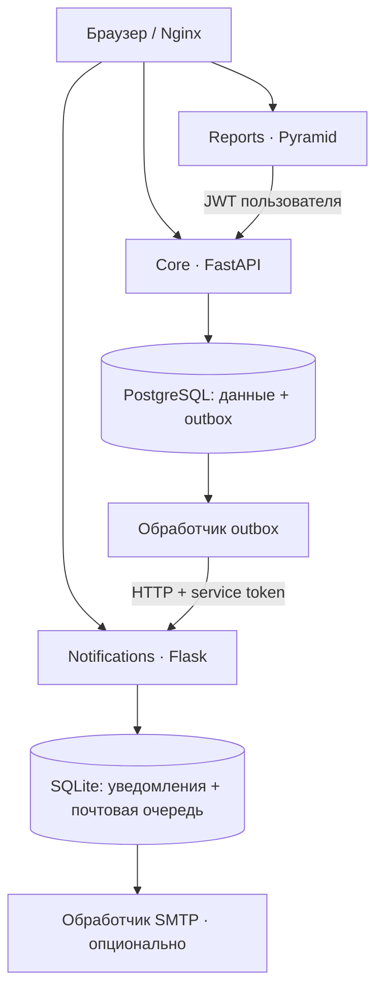

# Устройство и API

Архитектура сервисов, правила доступа, API и ограничения текущей версии.

[← Возможности приложения](../README.md) · [Конфигурация Railway](../deploy/railway/README.md)

## Устройство



| Компонент | Ответственность | Данные |
|---|---|---|
| `core/` | Пользователи, права, проекты, задачи, комментарии | PostgreSQL |
| `core/worker.py` | Чтение outbox, доставка HTTP, повторы | Таблица outbox в PostgreSQL |
| `notifications/` | Приём событий, личная лента, прочтение | Своя SQLite в томе |
| `notifications/worker.py` | SMTP и отложенные повторы | Почтовая очередь в SQLite |
| `reports/` | Подсчёт показателей, JSON и CSV | Получает разрешённые данные через Core API |
| `frontend/` | HTML, CSS, JavaScript без сборки; Nginx | Данные через API |
| `shared/` | Единые правила подписи и проверки JWT | Без базы |

Сервис отчётов передаёт токен пользователя в Core; проверка членства выполняется перед получением данных. Прямого доступа к чужим базам у него нет. Сервис уведомлений проверяет подпись JWT; изменять прочтение можно только в своей ленте. Приём событий защищён отдельным `SERVICE_TOKEN` и закрыт в Nginx.

Изменение задачи и записи outbox фиксируются одной транзакцией. Отдельный worker доставляет события и повторяет неудачные запросы с паузой до 5 минут. `event_id` уникален в сервисе уведомлений, поэтому повтор HTTP-запроса не создаёт вторую запись. Доставка — **at least once**. Для SMTP теоретически возможен повтор письма, если процесс завершится после отправки и до фиксации результата. SQLite уведомлений рассчитана на один экземпляр сервиса и один почтовый worker.

Удаление участника снимает его с задач. Авторство задач и комментариев сохраняется. Старые уведомления в личной ленте остаются, но открытие задачи после потери доступа запрещает Core.

## API

Общий заголовок защищённых запросов: `Authorization: Bearer <access_token>`.

| Метод и путь через Nginx | Действие |
|---|---|
| `POST /api/users/register` | `{name, email, password}` → токен и пользователь |
| `POST /api/users/login` | `{email, password}` → токен и пользователь |
| `GET /api/users/me` | Текущий пользователь |
| `GET /api/projects` | Доступные проекты: `limit`, `offset` |
| `POST /api/projects` | `{name, description?}` |
| `GET / PATCH / DELETE /api/projects/{id}` | Проект; изменение и удаление владельцем |
| `GET / POST /api/projects/{id}/members` | Участники; добавление через `{email}` |
| `DELETE /api/projects/{id}/members/{user_id}` | Исключить участника |
| `GET /api/tasks?project_id={id}` | Задачи: `status`, `priority`, `assignee_id`, `q`, `limit`, `offset` |
| `POST /api/tasks` | `{project_id, title, description?, status?, priority?, assignee_id?, due_date?}` |
| `GET / PATCH / DELETE /api/tasks/{id}` | Просмотр, изменение, удаление задачи |
| `GET / POST /api/tasks/{id}/comments` | Комментарии; создание через `{body}` |
| `DELETE /api/tasks/{id}/comments/{comment_id}` | Удаление комментария |
| `GET /notify/notifications` | `{items, total, unread_count}`; `limit`, `offset`, `unread_only` |
| `PATCH /notify/notifications/{event_id}/read` | Отметить прочитанным |
| `PATCH /notify/notifications/read-all` | Прочитать всё |
| `GET /reports-api/reports/projects/{id}` | JSON-отчёт |
| `GET /reports-api/reports/projects/{id}.csv` | Выгрузка CSV |

Списки Core: до 200 записей за запрос. Фронт загружает все страницы задач и проектов. `PATCH` меняет только переданные поля; `null` разрешён для очистки исполнителя и срока. Даты сроков в формате `YYYY-MM-DD`; просрочка определяется по дате UTC, завершённые задачи не учитываются. Внутренний `GET /projects/{id}/report-data` также защищён JWT и членством.

Пример создания проекта:

```bash
curl -X POST http://localhost:8080/api/projects \
  -H 'Authorization: Bearer YOUR_TOKEN' \
  -H 'Content-Type: application/json' \
  -d '{"name":"Первый проект","description":"Пробуем трекер"}'
```

## Границы текущей версии

Это основа для учебного проекта и дальнейшей разработки. Таблицы создаются при первом запуске через SQLAlchemy `create_all`; обновление существующей схемы потребует миграций. Нет восстановления пароля, подтверждения email, серверного отзыва JWT, вложений, realtime WebSocket и drag-and-drop: статусы меняются в карточке. Уведомления обновляют счётчик раз в 20 секунд; доска обновляется после собственных изменений и кнопкой повторного выбора проекта.

Отчёт загружает весь снимок задач проекта в память; это подходит для небольших команд. Публичная версия в Railway работает по HTTPS через прокси фронта. Для дальнейшей эксплуатации предстоит добавить ограничение частоты входа и регистрации, миграции, резервные копии, мониторинг очереди и очистку доставленных outbox-записей.

Официальная документация: [FastAPI: JWT и Argon2](https://fastapi.tiangolo.com/tutorial/security/oauth2-jwt/), [Flask: Gunicorn](https://flask.palletsprojects.com/en/stable/deploying/gunicorn/), [Pyramid: руководство](https://docs.pylonsproject.org/projects/pyramid/en/latest/quick_tutorial/).
